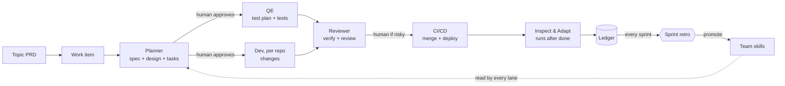
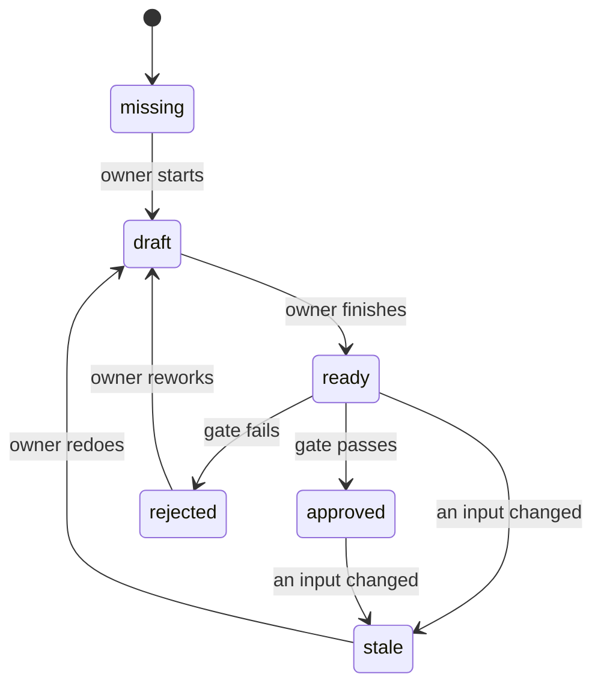
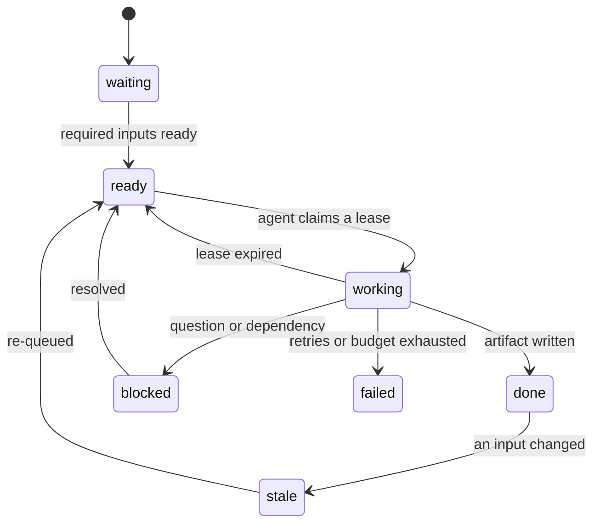
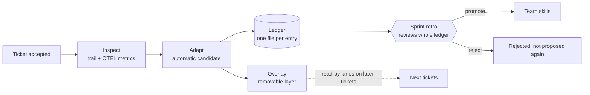
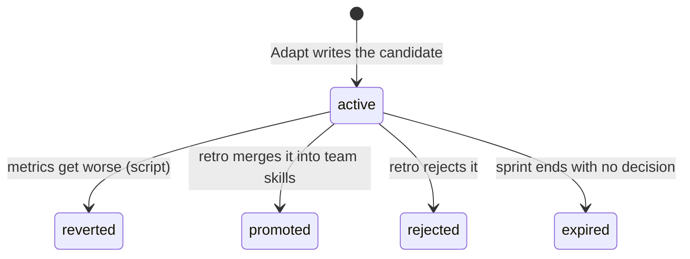

# LEGO AI workflow: design overview

Status as of 2026-11-03. This document describes the design the team has agreed so far, what is built, and what is still open.

## In one minute

- Each PRD topic from PI planning is split into work items (tickets). Each work item triggers **one run** of the flow.
- A run is not a fixed pipeline. **Independent agents, one per role (lane), work from shared artifacts.** A lane starts when its inputs are ready, not when the previous step finishes.
- Progress is tracked by **artifact status and lane status**. The ticket status is derived from them, never set by hand.
- Humans stay in control at a few **gates**: spec approval, risk-flagged review, and the sprint retro.
- When a ticket is done, an **Inspect & Adapt** lane learns from it automatically, using OTEL metrics from the agent sessions. Findings go into a **ledger**. At each sprint retro the team reviews the whole ledger and decides what to merge into the team-wide skills.

## Why not a traditional pipeline

| Traditional SDLC pipeline | This design |
|---|---|
| Order is hard-coded: A, then B, then C | Order comes from data: a lane starts when its input artifacts are ready |
| QE waits for Dev, or the reverse | QE and Dev start together once the spec is approved |
| A spec change means rewinding by hand | A changed input marks everything built from it as stale, and those lanes re-run on their own |
| Status lives in people's heads or a board | Status is derived from artifact and lane statuses |
| Lessons are learned in a retro, from memory | Every ticket is inspected automatically, with measured data, and the retro reviews a ledger |

## How a work item moves



Hierarchy: **PI planning → topic PRD → work item (ticket) → run.** A run is one turn of the flow. If the PRD changes or a ticket is rejected, a new run starts and keeps the old artifacts, marking the affected ones as stale.

## The lanes

A lane is one role's independent track of work. It has an owner, the artifacts it needs, the artifacts it produces, and its own status. A lane knows nothing about the other lanes. Agents never message each other; they only read and write artifacts.

| Lane | Needs | Produces | Gate |
|---|---|---|---|
| **Planner** | `ticket-context.md` | `spec.md`, `design.md`, `tasks.md` | Human approves the three together |
| **QE** | Approved spec and tasks | `test-plan.md`, tests per repo | None |
| **Dev** (one per repo) | Approved spec, design, tasks | `changes/<repo>/` | None |
| **Reviewer** | All changes, test plan | `verify-report.md`, `review-report.md` | Human when the change is risk-flagged |
| **Inspect & Adapt** | The whole trail and telemetry | `inspection-report.md`, ledger entries, overlay candidates | Sprint retro (see learning loop) |

Merge and deploy are plain CI/CD after review passes. They are not a lane, because they involve no agent decisions.

Naming rule: lanes are roles; artifacts are nouns with a suffix (`-plan`, `-report`). A word is never used for both, so "spec" always means the artifact and "Planner" always means the lane.

### Design decisions worth knowing

- **Planner explores and defines in one lane.** Exploring and specifying share one context, so splitting them only adds a hand-off.
- **The Jira criteria are the base of the spec.** The Planner adopts each Jira criterion as an AC and adds new ones only for what it found in the repos. A **traceability table** (Jira criterion, spec AC, kept / changed / dropped / added, reason) is read by the human at the spec gate, so a dropped scenario is caught before anything is built.
- **QE runs once, after the spec is approved.** An early QE round on the Jira text was considered and rejected: QE is rarely on the critical path, and a second round mostly rewrites the first. We will measure spec-approval wait against QE finishing after Dev, and revisit if QE becomes the bottleneck.
- **Reviewer verifies and reviews in one lane,** and is never the agent that produced the code or tests.

## Tracking status

### Artifacts

Every artifact carries a status and the hashes of the inputs it was built from.
When a tracked artifact file is present but has no recognized readiness status, it is shown and recorded as **draft**; mark it ready explicitly when its content is complete. A file's presence alone does not approve a gate or accept a ticket.



### Lanes



A lane becomes **ready** when every artifact it requires exists at the required status and none is stale. That one rule replaces the fixed order.

### Ticket status is derived

| Ticket status | Derived when |
|---|---|
| Planning | Planner lane is working, or the spec is ready but not approved |
| Needs input | Any lane is blocked on a human question |
| Building | Spec approved, and QE or any Dev lane is not done |
| In review | Verify report is ready, review is not approved |
| Deploying | Review passed, CI/CD running |
| Done | Accepted (policy still to be decided, see open items) |
| Escalated | A lane failed or a budget was exceeded |

PRD progress comes for free: each work item carries its PRD requirement ids, so a topic is complete when every requirement is covered by finished items, and uncovered requirements show up as gaps at PI planning.

## What happens when things go wrong

Agents **propose** events (`spec_gap`, `verify_failed`, `review_rejected`, `question_raised`, `escalate`). A small deterministic orchestrator applies them, so the thing that controls transitions is not itself non-deterministic.

| Situation | What happens |
|---|---|
| Verify fails in one repo | Only that repo's Dev lane re-runs, with the report as input |
| The spec turns out to be wrong | `spec_gap` re-queues the Planner; everything built on the old spec goes stale and re-runs |
| The spec changes mid-build | Dependent artifacts go stale automatically, including `design.md` and `tasks.md` (they record `spec.md` as an input); no one rewinds anything |
| An agent hangs or crashes | Its lease expires and the work returns to the queue |
| Retries or budget exhausted | The lane fails and the ticket escalates to a human |

## Multiple repos

Most tickets span several repos, and repos are deployed independently in about half the cases and in a fixed order in the other half. The design supports both.

- **Dev fans out per repo.** The Planner lists the affected repos in `tasks.md` with dependencies and a merge order. Each repo gets its own Dev instance, and a failure in one repo re-runs only that repo's Dev lane. Telemetry is tagged per repo, so Inspect & Adapt can see which repo caused rework.
- **Repo registry.** `config/repos.yaml` is the shared list of repos. Each developer says where the repos are on their own machine (a git-ignored local file, or one root folder), and the launcher starts each Dev session in the right repo and gives every session a map of all repo paths.
- **Release order is declared.** `tasks.md` ends with a Release section: `deploy_order: independent` or `ordered` (with the sequence and the reason). The Reviewer reads it for the risk check.
- **Risk is not triggered by multi-repo alone.** Independent multi-repo changes with no contract, schema, auth or infrastructure impact go to the AI reviewer. A change that must deploy in a fixed order always gets a human review.

Two parts are deliberately simple in this first version and are meant to be improved by the people who know them best (see Placeholders to improve below): cross-repo tests, and partial-failure handling when a release is only half done.

## Work kinds

The unit of work has a `kind`. Stories are the default.

| Kind | Source of "what to do" | Lanes | Notes |
|---|---|---|---|
| **story** | Jira criteria and PRD requirement ids | All | Traceability from Jira criteria to ACs |
| **chore** (tech debt, refactor, upgrade) | Intent and done criteria written by the requester | All | No PRD. If behavior-preserving, QE proves nothing changed and the Reviewer flags changed test expectations |
| **spike** (investigation) | A question, the decision it informs, a time box | Planner only | Produces `findings.md`. No code, tests or deploy. A human accepts the findings. Inspect & Adapt is off unless enabled |

Metrics are compared only within the same kind, so a spike never becomes a baseline for a story. Hotfix is not supported yet.

## Human gates and risk

Humans approve a few things; everything else flows.

- **Spec gate:** always. The human sees the spec, design, tasks and the traceability table.
- **Review gate:** only when the change is risk-flagged. Risk is computed from objective signals, not by an agent's judgment: a multi-repo change that must deploy in a fixed order, API contract, schema or migration, auth or secrets, CI or dependency changes, a large diff, incomplete AC coverage, or two or more rework loops. Otherwise an AI reviewer decides, with a human spot-check of about one in five.
- **Sprint retro:** the team reviews the ledger and promotes changes to the shared skills.

The rules that constrain agents (gates, risk rules, budgets, retry limits) are edited by humans only. Agents, including Inspect & Adapt, cannot change them.

## The learning loop



**Inspect** reads the full trail and the telemetry of each lane session: cost in tokens, time, attempts, rework loops, stale cascades, gate rejections, spec gaps, and AC coverage. It writes an inspection report with evidence for each finding.

**Adapt** turns a finding into a small candidate improvement and logs it in the ledger. It runs automatically, in **overlay mode**: the candidate is applied as a layer on top of the team skills, so later tickets benefit right away and the retro gets measured evidence. The team skills are never edited directly.

Guardrails on Adapt:

- It can change advisory content only (checklists, templates, hints, examples), never gates, budgets, risk rules or the team skills themselves.
- One change and one lane per candidate, at most three active candidates per lane, and each one expires after a sprint unless the retro keeps it.
- Evidence is required for every candidate, and Adapt reads the ledger first so it never re-proposes something already rejected.
- Each ticket records which candidates were active. After three tickets a script (not the proposing agent) compares metrics within the same kind and **reverts** a candidate that made rework, spec gaps or review rejections worse, or raised cost without a quality gain.
- Lower cost alone is never an improvement.
- Inspect & Adapt is independent: it is never the agent that did the work it inspects.



At **each sprint retro** the team reviews the whole ledger, sorted by evidence (recurrence and measured effect), merges similar entries, and decides to promote, keep for another sprint, or reject. Decisions are written back to the ledger.

## Measurement with OTEL

Inspect & Adapt works from OpenTelemetry data of the Copilot sessions, so findings rest on measurements and not only on reading artifacts.

- A launcher script starts each lane session with the Copilot file exporter on, and tags the session with `workflow.*` attributes: ticket, kind, run, lane, repo, attempt, a launch id, and the active overlay candidates. Raw telemetry lands in `otel-dump/` (git-ignored, since it can contain sensitive content).
- A check script verifies, after each lane session, that the attributes and token counts are present, and writes a summary to the ticket's `metrics/` folder.
- If telemetry is missing or incomplete, that is recorded, and Inspect & Adapt draws no conclusions about that lane's cost or time.
- OTEL shows cost and friction, never correctness. That is why a candidate only counts as an improvement when quality signals do not get worse.

## Safety principles

1. Agents write artifacts and propose events. Only the orchestrator and human gates change statuses.
2. One writer per artifact, through a lease that expires.
3. The agent that built something never signs it off.
4. Loops are bounded: a lane stops after three attempts (ticket-level limits are set to unlimited for now).
5. Self-improvement is contained: it is advisory, reversible, capped, evidenced, and reviewed by humans at the retro.
6. Rules that constrain agents are not editable by agents.

## Repository layout

```
config/      lanes, repos, risk rules, budgets, overlay rules  (humans edit)
skills/      shared rules (_common.md) and artifact templates  (changed only by retro promotion)
.github/agents/  one Copilot agent per lane: its instructions and allowed tools  (changed only by retro promotion)
overlay/     active candidates per lane                        (written by Adapt)
ledger/      one file per entry
tickets/     tickets/<ID>/run-<N>/ : manifest, events log, decisions, artifacts, metrics
otel-dump/   raw telemetry per session (git-ignored)
scripts/     new_ticket.py, wf_launch.py, otel_check.py, wf_status.py
docs/        this document
```

## Where we are

**Decided**

- PRD → work items → one run each; independent role lanes; artifact-driven readiness with a status model.
- Lanes and names: Planner, QE, Dev, Reviewer, Inspect & Adapt. Merge and deploy are CI/CD, not a lane.
- Jira criteria feed the spec with a traceability table; QE runs once after spec approval.
- Work kinds: story, chore, spike.
- Automatic Inspect & Adapt from OTEL metrics, logged in a ledger, in overlay mode, reviewed at each sprint retro, with promotion into team skills.
- Risk-based human review, with rules owned by humans.
- Ticket-level budgets unlimited for now; real values after the workflow is built.

**Built so far** (in the repository)

- Config, lane instructions, ticket and ledger templates for all three kinds.
- Scripts to create a work item, launch a lane session with telemetry tags (starting in the right repo folder), and check the telemetry. Tested on one real Copilot CLI dump and on synthetic data in the demo.
- A repo registry with per-developer local paths, and a declared release order per ticket.
- Templates for the artifacts that scripts or gates read by structure (`spec.md`, `tasks.md`, `test-plan.md`, `verify-report.md`, `review-report.md`), under `skills/<lane>/templates/`. Each marks the machine-read parts; `design.md` has none on purpose.
- A read-only status script (`wf_status.py`): from a ticket's manifest and the lane contracts it derives artifact staleness, lane states, the ticket status, and the next actions. It also warns when a machine-read part of an artifact is missing, for example `deploy_order` in `tasks.md` or `human_required` in `review-report.md`. It is the first slice of the orchestrator and is useful for a live demo, since it shows what is ready, what is stale and who has to act.
- A demo kit (`demo/`): one story across two fake repos, run step by step with scripted stand-in agents through the real launcher, status and telemetry scripts. It shows parallel lanes, a verify failure with a one-repo rework, staleness, risk-flagged review, ordered deploy, acceptance, and the Inspect & Adapt ledger and overlay. The demo script plays the orchestrator and the human, and the telemetry numbers are synthetic.

**Not built yet**

- The write side of the orchestrator exists as lane workers (`wf_run.py`, `wf_state.py`): leases, applying proposed events, updating the manifest, a CI/CD stand-in, human gate commands. It runs the whole DEMO-1 story from one trigger on the scripted agents. It has not run a real Copilot story yet; the Copilot command in `config/runner.yaml` is unverified.
- The auto-revert script and the ledger tooling for the retro.
- PI-level tracking and capacity reporting for chores and spikes.

**Open**

| Item | Note |
|---|---|
| Acceptance policy | Suggested default to try: a ticket is accepted by evidence (deployed and healthy, every AC covered by a passing test, no blocking comments), with a human sign-off when risk-flagged or user-visible. The PO accepts at the requirement level when all its tickets are done. Not decided. |
| OTEL field names and credits | Confirmed on one real Copilot CLI dump (see the telemetry notes in `docs/pilot-spike.md`): tags, session id, tokens, `github.copilot.cost` and `github.copilot.nano_aiu` are all present. Still open: how `nano_aiu` maps to billing, and what VS Code and IntelliJ export. |
| Real budgets | Set from the first few tickets' metrics. |
| Hotfix kind | Not supported yet. |
| Risk thresholds | Starting values (for example a 400-line diff) to be tuned at the retro. |

### Placeholders to improve

These work in a simple form so the skeleton is runnable end to end. Each one is meant to be improved by the people who know the area best.

| Area | How it works now | To improve (suggested owner) |
|---|---|---|
| Cross-repo tests | QE lists integration scenarios (given / when / then) in the test plan; automation is optional; the Reviewer runs any tests in `tests/integration/` and lists the rest as manual | A real integration or contract test layer across services (QE) |
| Release order and partial failure | The release order is declared in `tasks.md` and CI/CD follows it; on the first failure it stops, escalates, and records what is already merged or deployed | Automated ordered deploys, handling of a half-finished release, rollback (Dev) |
| Lane instructions | A first version for each lane, written from the design | Each lane refined by the people who do that work, using what the pilot shows (Dev, QE, Planner, Reviewer) |
| Risk thresholds | Starting values, for example a 400-line diff | Tuned at the retro from the ledger |

## Suggested rollout

1. **Pilot one real story** through the launcher and the check script. Confirm the telemetry fields, and note how long the spec waited for approval.
2. **Run one sprint** with the manual manifest, to see whether the lanes and artifacts fit how the team works.
3. **Build the orchestrator** on what the pilot showed. (Lane workers are built and proven on the scripted agents; next is a real run.)
4. **First retro with a ledger**, reviewing the first Inspect & Adapt candidates and deciding what to promote.
5. **Set real budgets and the acceptance policy** from the collected data.

## Glossary

| Term | Meaning |
|---|---|
| Work item | A ticket (story, chore or spike) that triggers one run |
| Run | One turn of the flow for a work item |
| Lane | One role's independent track: what it needs, what it produces, its status |
| Artifact | A file produced by a lane (spec, test plan, changes, reports) with a status and input hashes |
| Stale | An artifact whose input changed after it was built |
| Gate | A point where a human approves before work continues |
| Lease | A time-limited claim that lets one agent write an artifact |
| Ledger | The append-only record of improvement candidates, one file per entry |
| Overlay | A removable layer of candidate improvements on top of the team skills |
| Retro | The sprint review where the team decides what to promote into the team skills |
